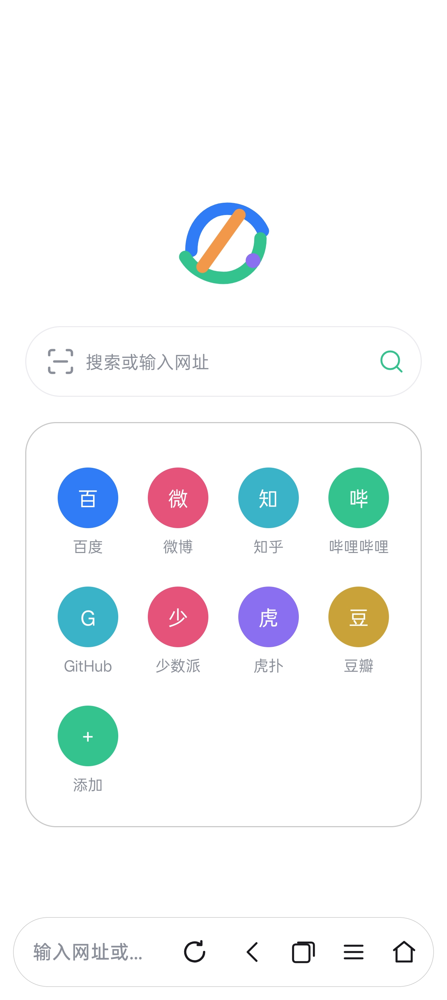
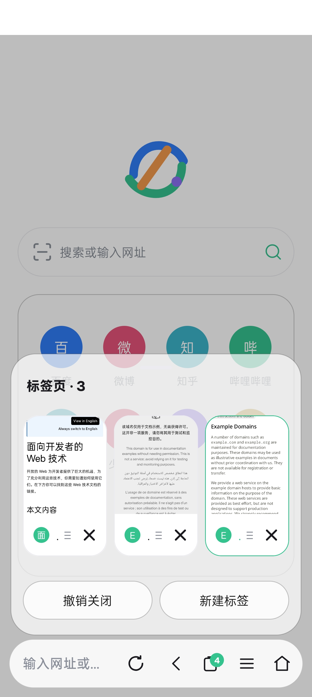
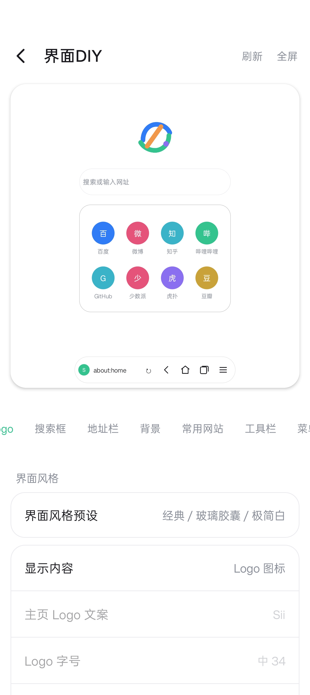
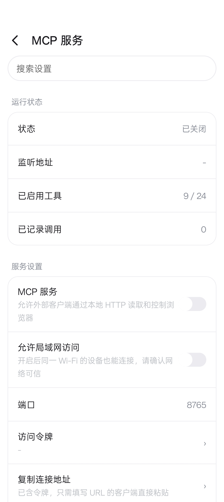

<h1 align="center">Sii Browser</h1>

<p align="center"><b>English</b> | <a href="README.md">中文</a></p>

<p align="center">An Android browser written in Kotlin</p>

<p align="center">
  <a href="https://github.com/wanwuwww/Sii-Browser/releases">
    
  </a>
  
  
  
</p>

<p align="center"><a href="https://wanwuwww.github.io/Sii-Browser/">Website &amp; screenshots</a></p>

## Features

- Multiple tabs and a tab panel, with thumbnails and recently closed tabs
- Ad blocking and privacy protection: rule subscriptions, custom rules, per-site switches
- Page translation: online, offline and bilingual
- Download manager: multi-connection, resume and HLS
- Media sniffing and a built-in player
- User scripts with common GM APIs
- Local MCP service and network capture for external tools
- UI DIY: toolbar, menu, theme and glass strength

## Screenshots

<p align="center">
  
  
</p>

<p align="center">
  
  
</p>

## Download

Download `Sii-x.y.z.apk` from [Releases](https://github.com/wanwuwww/Sii-Browser/releases).

- arm64-v8a only, Android 8.0 (API 26) and above
- The release build is signed and can be installed over the previous version

## Build

Requires JDK 17 and Android SDK 36:

```bash
./gradlew assembleRelease
```

## License

The source is public under a non-commercial license: personal learning, research and modification are allowed; commercial use and app store distribution are not. See [LICENSE.md](LICENSE.md).

## Feedback

Open an [Issue](https://github.com/wanwuwww/Sii-Browser/issues) with steps to reproduce and device information.
