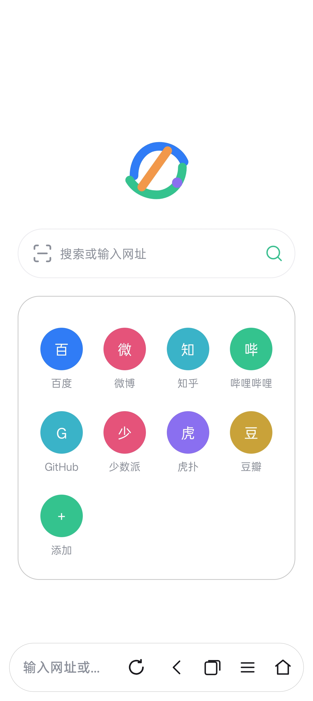
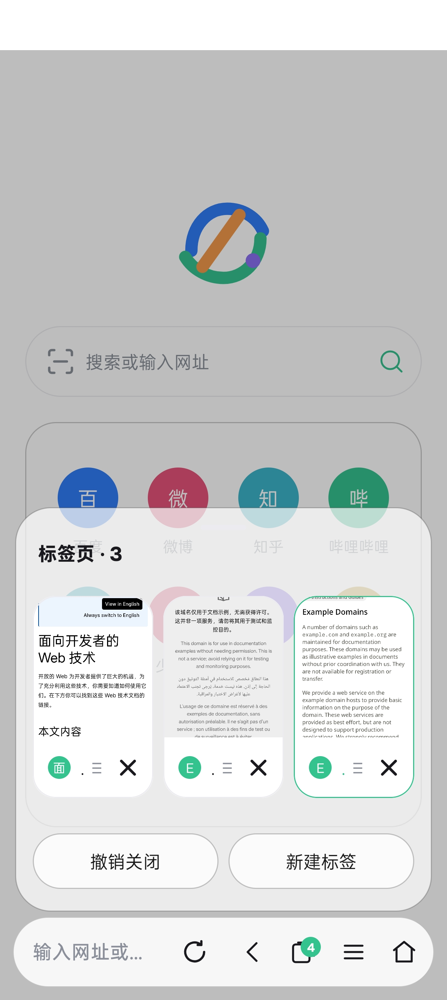
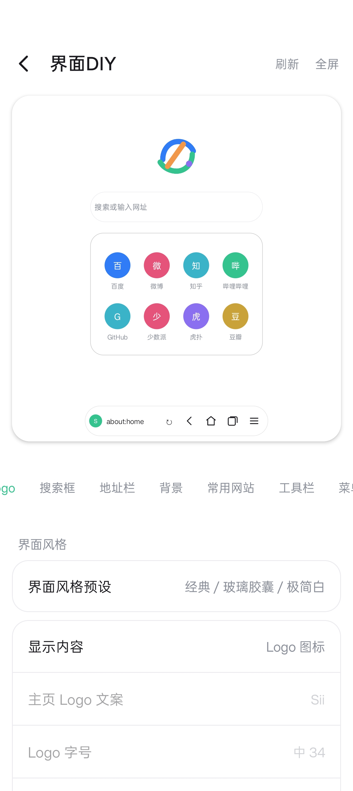
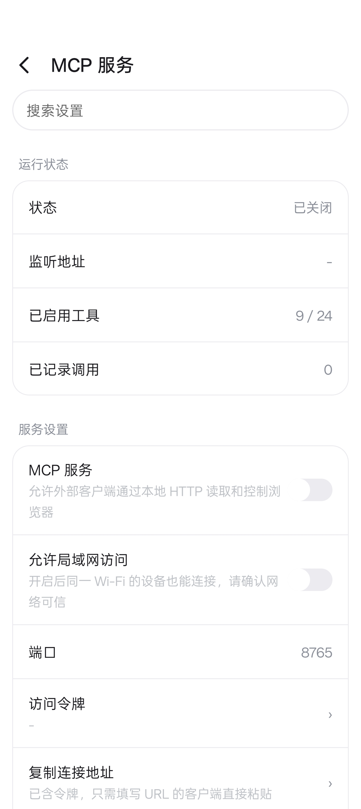

<h1 align="center">Sii Browser</h1>

<p align="center"><a href="README.en.md">English</a> | <b>中文</b></p>

<p align="center">用 Kotlin 写的 Android 浏览器</p>

<p align="center">
  <a href="https://github.com/wanwuwww/Sii-Browser/releases">
    
  </a>
  
  
  
</p>

<p align="center"><a href="https://wanwuwww.github.io/Sii-Browser/">官网与截图</a></p>

## 功能

- 多标签与标签面板，支持缩略图、恢复最近关闭
- 广告拦截与隐私保护，规则订阅、自定义规则、按站开关
- 网页翻译，支持在线、离线与双语对照
- 下载管理：多连接、断点续传、HLS
- 资源嗅探与内建播放器
- 用户脚本，兼容常用 GM 接口
- 本地 MCP 服务与页面抓包，可对接外部工具
- 界面 DIY：工具栏、菜单、主题、玻璃强度

## 截图

<p align="center">
  
  
</p>

<p align="center">
  
  
</p>

## 下载

前往 [Releases](https://github.com/wanwuwww/Sii-Browser/releases) 下载 `Sii-x.y.z.apk`。

- 仅支持 arm64-v8a，Android 8.0（API 26）及以上
- 正式签名，可直接覆盖升级

## 构建

需要 JDK 17 与 Android SDK 36：

```bash
./gradlew assembleRelease
```

## 许可

源码公开，采用非商业许可：允许个人学习、研究与修改，禁止商业使用和应用商店分发。详见 [LICENSE.md](LICENSE.md)。

## 反馈

问题或建议请提交 [Issue](https://github.com/wanwuwww/Sii-Browser/issues)。
